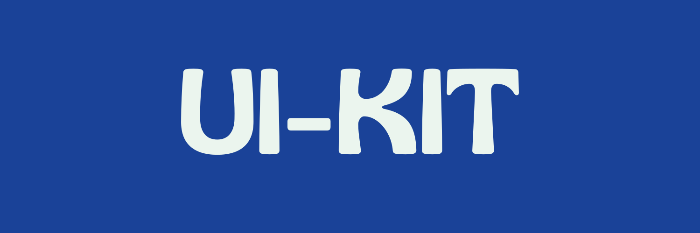

<p align="center">
  <a href="https://nexora.dev">
    
  </a>
</p>

<p align="center">
  <h1 align="center">NexoraUi-Kit</h1>
  <p align="center"><strong>Kit de componentes de interfaz de usuario para la suite Nexora</strong></p>
  <p align="center">Acelera el desarrollo inicial manteniendo la cohesión, calidad y convenciones de diseño de la organización.</p>
</p>

<p align="center">
  
  
  
  
</p>

---

## Tabla de Contenidos

- [Estado del proyecto](#estado-del-proyecto)
- [Acerca de](#acerca-de)
- [Características principales](#características-principales)
- [Tecnologías y Stack](#tecnologías-y-stack)
- [Requisitos previos](#requisitos-previos)
- [Instalación y Configuración](#instalación-y-configuración)
- [Uso](#uso)
- [Estructura del proyecto](#estructura-del-proyecto)
- [Hoja de ruta](#hoja-de-ruta)
- [Contribuir](#contribuir)
- [Seguridad](#seguridad)
- [Licencia](#licencia)

---

## Estado del proyecto

> **Estado actual:** Activo / En uso como plantilla oficial de Nexora.

## Acerca de

**NexoraUi-Kit** es el kit de interfaz de usuario compartido del ecosistema Nexora. Proporciona los componentes estándar de la ventana (`NexoraWindowHeader`, `NexoraActionBar`, `NexoraFooterBar`) y la paleta monocromática común (`NexoraColors`, `NexoraTheme`) para mantener la cohesión visual entre Nexora Suite, Harmony y el resto de aplicaciones.

## Características principales

- **Componentes de ventana compartidos:** `NexoraWindowHeader`, `NexoraActionBar`, `NexoraFooterBar`.
- **Paleta monocromática unificada:** `NexoraColors` y `NexoraTheme` para toda la suite.
- **Estandarización inmediata:** Incluye documentación base (`CONTRIBUTING.md`, `SECURITY.md`, `CHANGELOG.md`).
- **Convenciones preconfiguradas:** Alineado con los flujos de trabajo y buenas prácticas de Nexora.

## Tecnologías y Stack

- `Flutter / Dart`
- `window_manager` para el control nativo de la ventana
- `font_awesome_flutter` para iconografía consistente

## Requisitos previos

Antes de comenzar, asegúrate de contar con lo siguiente en tu entorno de desarrollo:

- `Flutter SDK (>=3.24.0)`
- `Dart SDK (^3.13.7)`

## Instalación

Clona este repositorio y configura el entorno inicial ejecutando los siguientes comandos:

```bash
# 1. Clona el repositorio
git clone [https://github.com/tu-organizacion/NexoraTemplate.git](https://github.com/tu-organizacion/NexoraTemplate.git) mi-nuevo-proyecto

# 2. Entra al directorio
cd mi-nuevo-proyecto

# 3. Instala las dependencias
flutter pub get
```

## Uso

Instrucciones rápidas para integrar el kit en una aplicación:

```dart
import 'package:nexora_ui_kit/nexora_ui_kit.dart';

// En el árbol de widgets:
const NexoraWindowHeader(subtitle: 'HARMONY')
```

## Estructura del proyecto

```text
./
├── lib/
│   ├── nexora_ui_kit.dart # Barrel de exportación
│   ├── src/
│   │   ├── theme/        # NexoraColors y NexoraTheme
│   │   └── widgets/      # NexoraWindowHeader, NexoraActionBar, NexoraFooterBar
│   └── ...
├── test/                 # Pruebas de widgets
├── assets/fonts/         # Tipografía Gliker
├── pubspec.yaml          # Dependencias del paquete
├── CONTRIBUTING.md       # Guía para contribuidores
├── SECURITY.md           # Política de seguridad y vulnerabilidades
├── CHANGELOG.md          # Historial de cambios
└── README.md             # Documentación principal

```

## Hoja de ruta

- [x] Configuración inicial del stack Flutter completada.
- [ ] Configurar pipelines de CI/CD automatizados.

## Contribuir

Las contribuciones son bienvenidas. Por favor, lee el archivo [CONTRIBUTING.md](CONTRIBUTING.md) para conocer los detalles sobre nuestro código de conducta y el proceso para enviar pull requests.

## Seguridad

Si descubres alguna vulnerabilidad de seguridad, por favor consulta nuestra política en [SECURITY.md](SECURITY.md) para saber cómo reportarla de forma responsable.

## Licencia

Este proyecto se distribuye bajo los términos de la licencia **MIT** (consulta el archivo [LICENSE](LICENSE) para más detalles, SPDX: `MIT`).

> **Nota de marca:** _Nexora_ es titular de todos los derechos de marca. El nombre, la identidad visual y los logotipos de Nexora no pueden ser utilizados ni redistribuidos sin autorización previa por escrito.

---

<p align="center">
  Un proyecto desarrollado por el equipo de <strong>Nexora</strong>.
</p>
